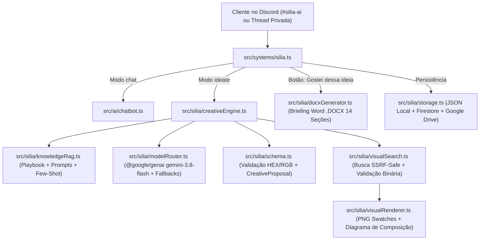

# Arquitetura Técnica — Silia Creative Intelligence (LWX Lab Bot)

Este documento descreve a arquitetura modular implementada para transformar a **Silia AI** em uma Diretora Criativa e Assistente Conversacional de Design no **LWX Lab Bot**.

---

## 1. Visão Geral dos Módulos

---

## 2. Componentes Principais

| Arquivo | Responsabilidade |
| :--- | :--- |
| [`src/silia/types.ts`](../../src/silia/types.ts) | Contratos TypeScript para sessões, propostas (`CreativeProposal`), amostras de cor (`ColorSwatchSpec`), roteiro visual (`VisualScriptBeat`), rejeições e briefings aprovados. |
| [`src/silia/schema.ts`](../../src/silia/schema.ts) | Normalização e validação de cores HEX/RGB, JSON Schema para saída estruturada do `gemini-3.8-flash` e validação defensiva de propostas. |
| [`src/silia/modelRouter.ts`](../../src/silia/modelRouter.ts) | Roteador oficial `@google/genai` com suporte a `gemini-3.8-flash` (`thinkingLevel`: `LOW`, `MEDIUM`, `HIGH`), sanitização de histórico e cascata de fallbacks (`gemini-3.6-flash` -> `gemini-3.5-flash-lite` -> OpenAI -> Gemini API Key -> Pollinations -> Local Archetype Director). |
| [`src/silia/knowledgeRag.ts`](../../src/silia/knowledgeRag.ts) | Indexação leve e recuperação contextual (RAG) sobre o [`SILIA_CREATIVE_PLAYBOOK.md`](./SILIA_CREATIVE_PLAYBOOK.md), prompts versionados em `docs/silia/prompts/` e exemplos few-shot positivos/negativos. |
| [`src/silia/visualRenderer.ts`](../../src/silia/visualRenderer.ts) | Renderizador PNG programático puro em TypeScript (`node:zlib`) que gera amostras visuais de cor, barras proporcionais de paleta e diagramas de composição/ponto focal sem dependências nativas externas. |
| [`src/silia/visualSearch.ts`](../../src/silia/visualSearch.ts) | Busca de referências visuais com proteção SSRF (bloqueio de IPs privados/loopback e `file://`), inspeção binária de magic bytes (PNG/JPEG/GIF/WebP) e integração com o acervo de referência do estúdio. |
| [`src/silia/creativeEngine.ts`](../../src/silia/creativeEngine.ts) | Descoberta adaptativa não-burocrática, geração de propostas estruturadas, controle de 1ª e 2ª recusas com mudança substancial de direção e modo de diagnóstico adaptativo a partir da 3ª recusa. |
| [`src/silia/docxGenerator.ts`](../../src/silia/docxGenerator.ts) | Geração do documento editável `.docx` com Capa + 14 seções, amostras PNG de cor embutidas na tabela, diagrama de composição PNG embutido e referências visuais. |
| [`src/silia/storage.ts`](../../src/silia/storage.ts) | Persistência operacional em disco (`data/silia-sessions.json`), sincronização com Firestore e upload automático para o Google Drive (`Silia AI/Briefings` e `Silia AI/Sessions`). |

---

## 3. Fluxo de Botões e Interações no Discord

1. **Nas Propostas Criativas:**
   - **`Gostei dessa ideia`** (`lwx:silia:proposal_approve:<proposalId>`): Congela a proposta aprovada, gera o `.docx` completo, faz upload para o Drive (se configurado) e entrega o arquivo no chat junto aos botões finais.
   - **`Prefiro outra ideia`** (`lwx:silia:proposal_reject:<proposalId>`):
     - **1ª e 2ª recusas:** Gera imediatamente uma direção criativa substancialmente diferente (novo arquétipo estético, nova paleta HEX, nova composição e tipografia).
     - **3ª recusa em diante:** Ativa o **Diagnóstico Criativo Adaptativo**, apresentando botões rápidos (`Mudar Cores & Paleta`, `Mudar Estilo & Clima`, `Mudar Composição & Fonte`, `Nova Ideia do Zero`) e permitindo que o cliente explique no chat o que deseja ajustar, sem limite máximo de tentativas.
2. **Na Entrega do Briefing `.docx`:**
   - **`Continuar Chat`** (`lwx:silia:continue_chat`): Mantém o atendimento aberto no modo conversa livre preservando o briefing salvo.
   - **`Abrir Orçamento com Esta Ideia`** (`lwx:silia:to_briefing`): Abre o modal de orçamento do LWX Lab já preenchido com o resumo executivo da proposta aprovada.
   - **`Finalizar Atendimento`** (`lwx:silia:finalize_close`): Encerra e exclui a thread privada da Silia AI (`🔒・silia-usuario`) após 3 segundos para evitar que salas antigas fiquem abertas indefinidamente.
3. **Botão `Limpar Conversa` (`lwx:silia:clear`):**
   - Limpa o estado completo da sessão e apaga as mensagens da conversa tanto dentro da **Thread Privada** quanto no canal principal da Silia AI.
